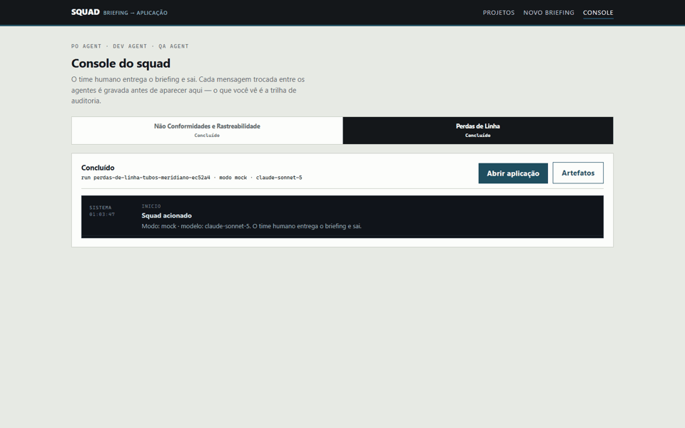
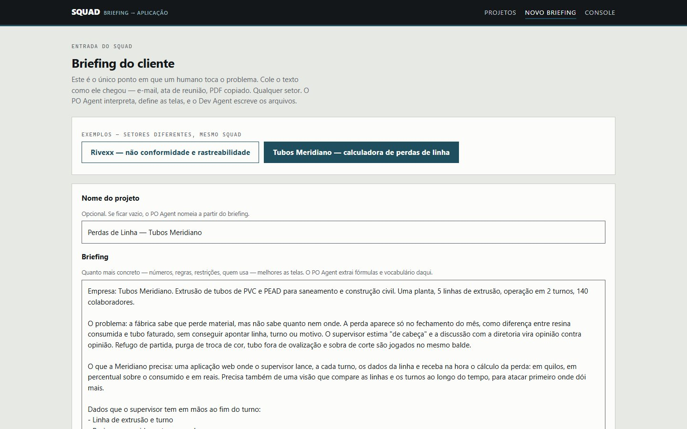
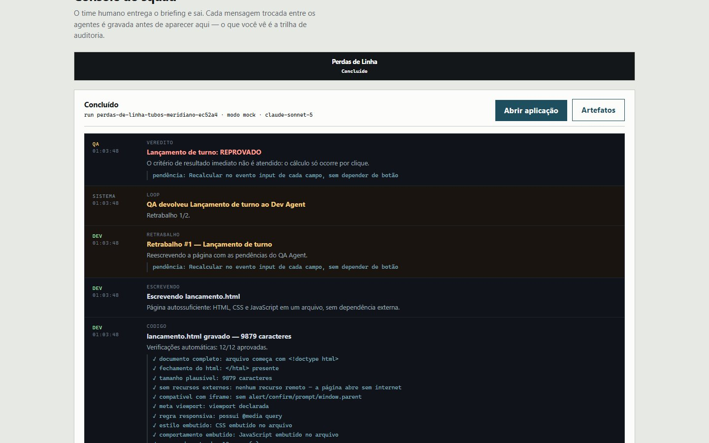
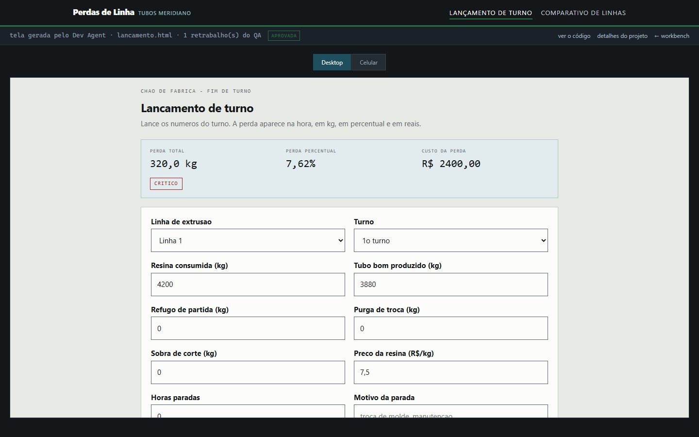
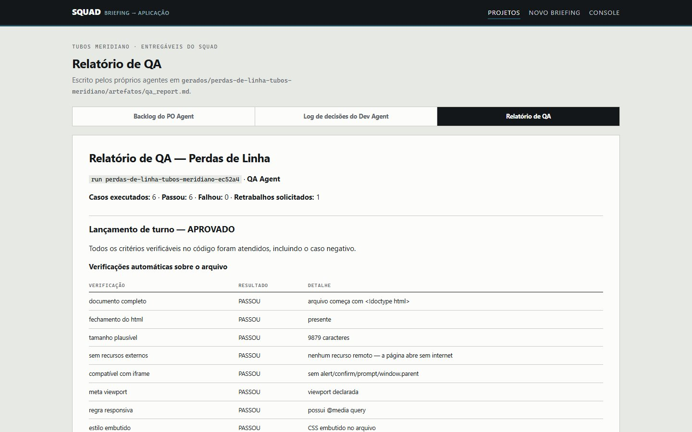
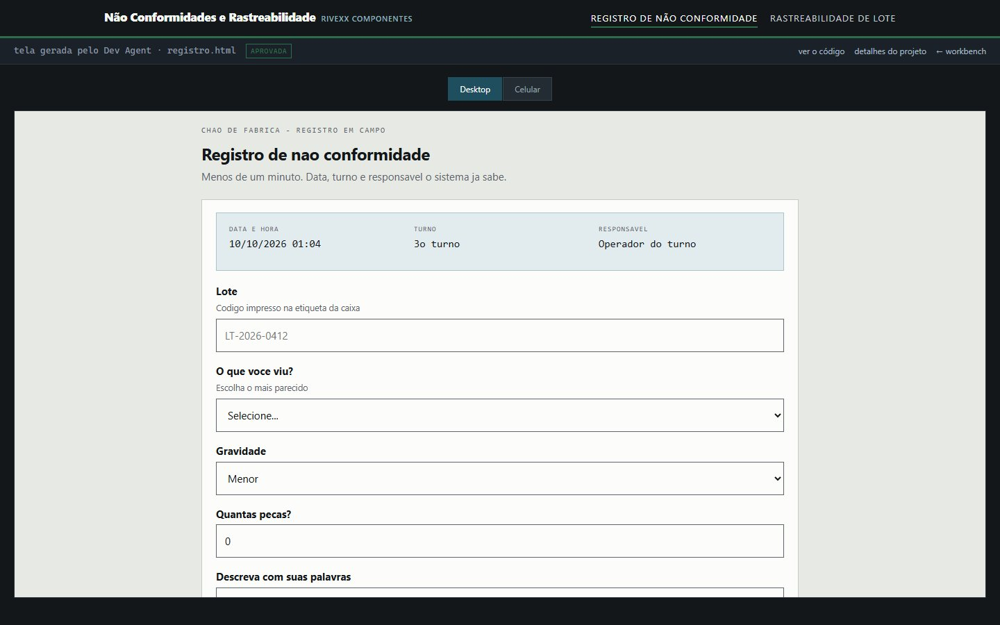

# Squad Forge — briefing entra, aplicação sai

> 🏆 **3º lugar no hackathon da Reply.**

Um squad de três agentes de IA — **PO, Dev e QA** — recebe o briefing bruto de um cliente
qualquer, interpreta o domínio, decide quais telas a aplicação precisa ter, **escreve os
arquivos** e testa cada um antes de liberar. As páginas entregues não existem antes da
execução: outro briefing gera outra aplicação.



## O desafio do hackathon

O desafio era construir uma **orquestração de agentes de IA** que funcionasse como uma linha
de produção de software: alguém descreve o que precisa e os agentes, cada um com seu papel,
entregam a tela pronta e testada — sem um humano no meio do caminho.

A resposta do Squad Forge foi tratar os agentes como um time de verdade, com contratos
claros entre eles:

- o **PO** é o único que lê o briefing do cliente; ele extrai domínio, vocabulário e
  fórmulas, define as telas e escreve critérios de aceite;
- o **Dev** recebe só a tela e os critérios (nunca o briefing original), registra as
  decisões técnicas e escreve um arquivo HTML autossuficiente por tela;
- o **QA** recebe só o código-fonte e os critérios, roda verificações automáticas e
  aprova ou devolve a tela ao Dev com as pendências.

```
briefing -> PO Agent   domínio + telas + critérios de aceite
               |
            Dev Agent  decisões técnicas -> escreve tela.html no disco
               |
            QA Agent   12 verificações automáticas + revisão do código-fonte
               |
      APROVADO -> próxima tela        REPROVADO -> volta ao Dev (até 2x)
```

## Veja funcionando

| | |
|---|---|
|  |  |
| **1. Briefing.** Só texto, como chegou do cliente. | **2. Console.** O QA reprova, devolve ao Dev, e a nova versão passa nas 12 verificações. |
|  |  |
| **3. A aplicação entregue.** A perda recalcula a cada campo e é classificada como crítica acima de 7%. | **4. Entregáveis.** Backlog, log de decisões e relatório de QA escritos pelos agentes. |



**5. Outro briefing, outro produto.** Mesmo squad, mesma plataforma — o briefing da Rivexx
(não conformidades e rastreabilidade) gera telas completamente diferentes. Se a aplicação
fosse fixa no código, ela não mudaria.

> As capturas foram feitas no modo offline (`SQUAD_MODE=mock`), que percorre o mesmo grafo,
> o mesmo gate de 12 verificações e o mesmo ciclo de retrabalho com respostas gravadas. No
> modo `live`, o Claude escreve as telas do zero a cada briefing.

## Por que não há demo online

No modo `live`, cada briefing consome tokens da chave da Anthropic de quem hospeda. Uma
demo pública significaria deixar qualquer pessoa gastar a chave de outra — por isso o
projeto é publicado sem chave, e a forma de ver funcionando é rodar na sua máquina (abaixo)
ou pelas capturas acima.

## Rodar na sua máquina

Precisa de Python 3.12. A chave da Anthropic é opcional: sem ela, use o modo offline.

```powershell
python -m venv venv
.\venv\Scripts\Activate.ps1        # Linux/macOS: source venv/bin/activate
pip install -r requirements.txt
copy .env.example .env             # Linux/macOS: cp .env.example .env
```

**Sem chave (modo offline):**

```powershell
$env:SQUAD_MODE="mock"             # Linux/macOS: export SQUAD_MODE=mock
uvicorn app.main:app --reload
```

**Com chave (agentes de verdade):** cole a sua `ANTHROPIC_API_KEY` no `.env` e rode
`uvicorn app.main:app --reload`. Uma execução completa custa alguns centavos.

Abra <http://localhost:8000>, vá em **Novo briefing**, escolha um dos exemplos e clique em
**Acionar o squad**.

### Tour sugerido

1. **`/briefing`** → exemplo "Tubos Meridiano — calculadora de perdas". É só texto. Acione.
2. **`/squad`** → o PO extrai as fórmulas do briefing; o Dev decide e escreve
   `lancamento.html`; o QA reprova e devolve. Esse é o momento.
3. **`/app/{projeto}`** → a calculadora funcionando. Digite resina 4200, tubo bom 3910: a
   perda recalcula sozinha (6,90%, atenção). Troque o tubo bom para 3880: passa de 7% e
   vira crítica. Grave. Alterne para Celular.
4. **"ver o código"** → o HTML que o agente escreveu, na íntegra.
5. **`/briefing`** → exemplo "Rivexx". Acione. Telas completamente diferentes.
6. **`/artefatos/{projeto}`** → backlog, decisões e o relatório de QA com as 12
   verificações automáticas por tela.

O console em `/squad?run=<id>` reproduz qualquer execução a partir do banco.

## Como funciona

### O que é gerado e o que é infraestrutura

**Gerado pelo squad, do zero, a cada briefing:**
- quais telas existem, seus nomes, tipos e objetivos
- todo o HTML, CSS e JavaScript de cada tela
- o vocabulário e as fórmulas usadas na interface
- o backlog, o log de decisões e o relatório de QA

**Fixo — é a plataforma:**
- o servidor, a API de armazenamento, o console e o visualizador
- o gate de 12 verificações automáticas
- o grafo de orquestração

A analogia: **o runtime é o compilador, os agentes escrevem o programa.**

### Por que o QA não é teatro

Antes do QA Agent opinar, `app/squad/gate.py` roda **12 asserções em Python sobre o
arquivo entregue**: documento completo, `</html>` presente, nenhum recurso externo,
compatível com iframe, meta viewport, `@media`, `<style>`, `<script>`, integração com o
armazenamento, número de campos, listener de recálculo, marcação balanceada.

Qualquer verificação que falhe **força REPROVADO**, independentemente do que o modelo ache.
O QA Agent então lê o código-fonte de verdade e escreve casos de teste citando `id`, função
ou seletor como evidência. Reprovou, o Dev reescreve a página inteira com as pendências.
Duas tentativas; na terceira a tela vai marcada como bloqueada.

### O contrato que as páginas geradas recebem

Toda tela gerada roda no navegador e tem um armazenamento pronto — schemaless de propósito,
porque um briefing sobre tubos e outro sobre injeção plástica produzem registros diferentes:

```js
// gravar
await fetch('/api/apps/<projeto>/records', {
  method: 'POST', headers: {'Content-Type':'application/json'},
  body: JSON.stringify({ tipo: 'lancamentos', dados: { linha: 'Linha 3', perda_kg: 290 } })
});   // a resposta inclui 'hash': os 16 primeiros caracteres do SHA-256 do registro

// ler
const { registros } = await (await fetch('/api/apps/<projeto>/records?tipo=lancamentos')).json();
```

O Dev Agent recebe esse contrato no prompt e escolhe os nomes de coleção pelo domínio do
briefing.

### Onde fica cada coisa

| O que | Onde |
|---|---|
| **Entrada do briefing** | `/briefing` — cole qualquer texto de cliente |
| **O que o PO recebe** | `app/squad/prompts.py` → `po_user()` |
| **Handoff PO → Dev** | `prompts.dev_plan_user()` e `dev_code_user()` |
| **Handoff Dev → QA** | `prompts.qa_user()` — critérios + código-fonte, nada mais |
| **O squad** | `app/squad/graph.py` → `build_graph()` |
| **Toda mensagem trocada** | tabela `squad_events`, exibida em `/squad` |
| **A aplicação do cliente** | `/app/{projeto}` — telas em `gerados/{projeto}/*.html` |
| **Entregáveis** | `/artefatos/{projeto}` — backlog, decisões, relatório de QA |

### Estrutura

```
app/
  main.py            workbench: briefing, console, hospedagem das apps, storage API
  db.py              projetos, telas, trilha de auditoria, app_records (schemaless)
  llm.py             call_json + call_text, único ponto de troca de provider
  squad/
    prompts.py       os três contratos + os handoffs + briefings de exemplo
    graph.py         LangGraph: nós, roteadores, escrita dos arquivos e artefatos
    gate.py          12 verificações automáticas sobre o HTML entregue
    bus.py           trilha de auditoria
    mock.py          modo offline com páginas reais
gerados/<projeto>/   *.html escritos pelo Dev Agent + artefatos/*.md
docs/demo/           capturas usadas neste README
```

### Configuração

| Variável | Padrão | Para quê |
|---|---|---|
| `ANTHROPIC_API_KEY` | — | console.anthropic.com → API Keys |
| `SQUAD_MODE` | `live` | `mock` roda offline, sem chave |
| `ANTHROPIC_MODEL` | `claude-sonnet-5` | modelo dos três agentes |
| `SQUAD_MAX_TOKENS` | `8000` | teto das chamadas JSON |
| `SQUAD_MAX_TOKENS_CODIGO` | `16000` | teto da chamada que escreve a página |

O `.env` está no `.gitignore` — a chave nunca vai para o repositório.
